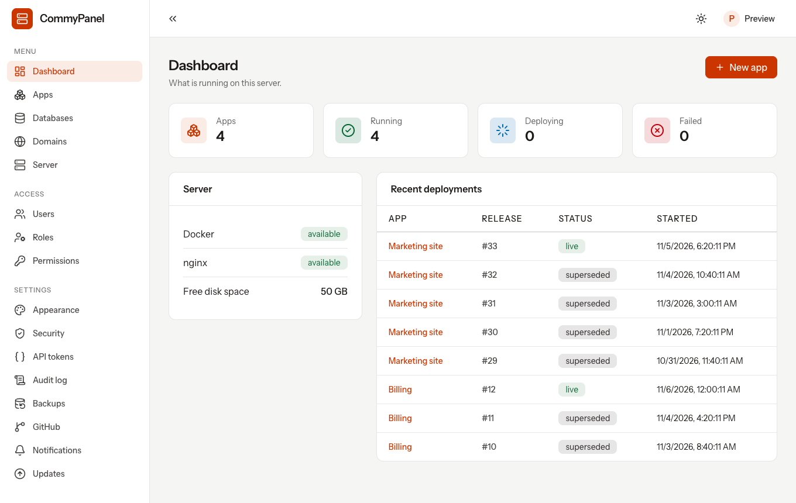
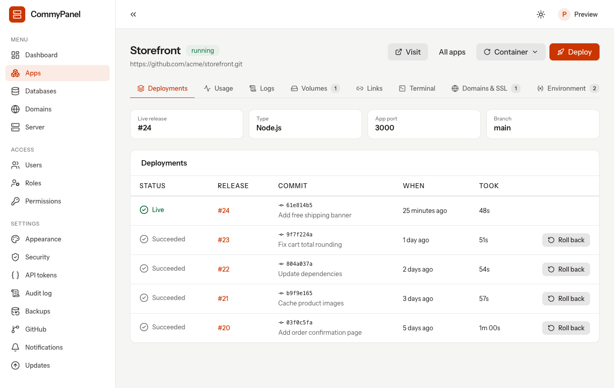
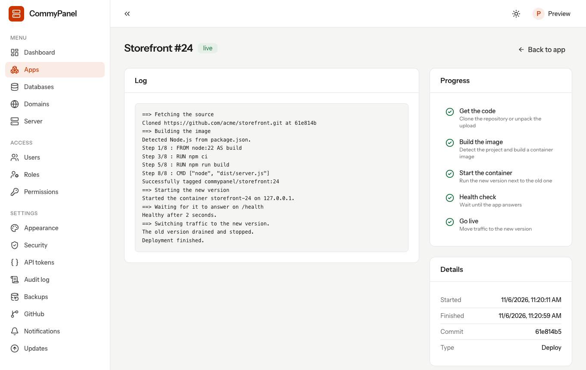
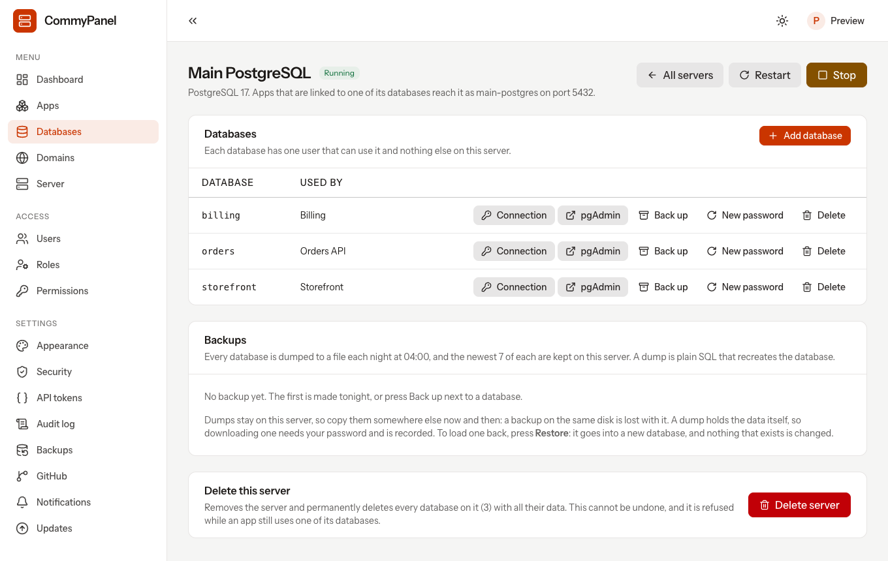
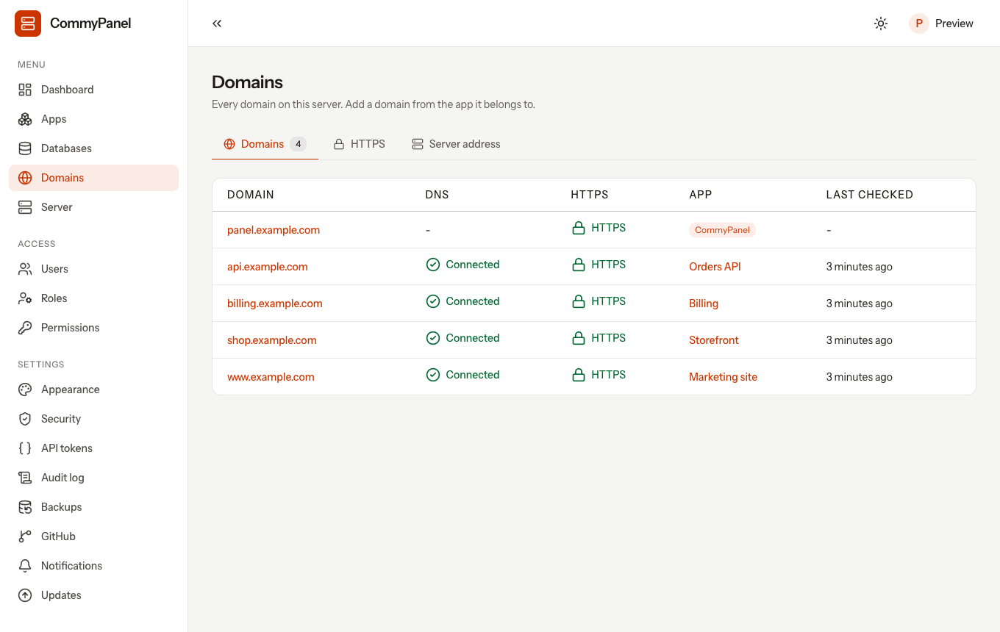
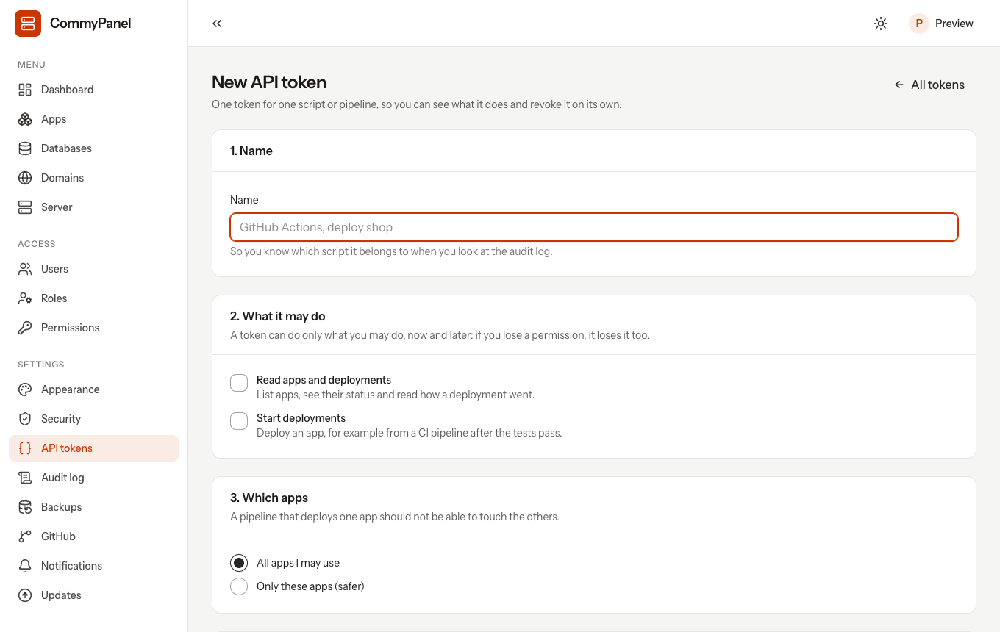
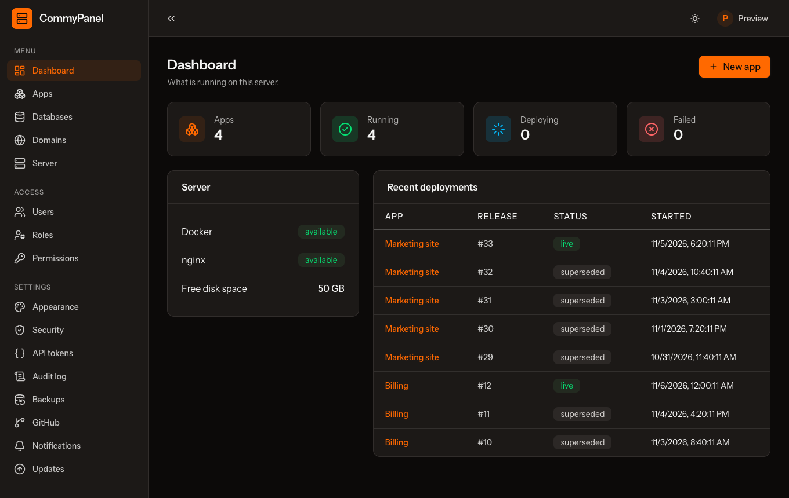
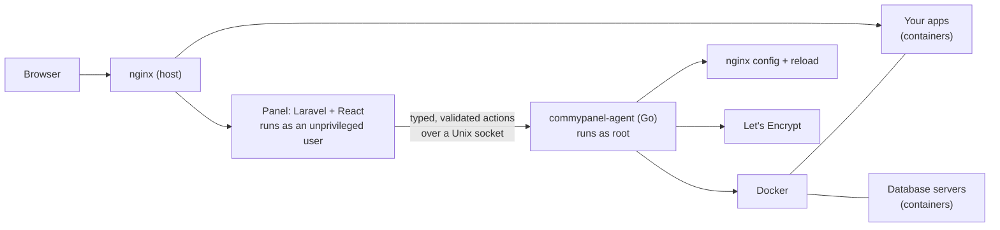

<div align="center">

# CommyPanel

**A self-hosted server control panel for running your own apps, domains and databases on one server.**

Deploy .NET, Go and Node apps from Git with zero downtime, connect domains with automatic HTTPS, and run PostgreSQL, MySQL and MariaDB, all from one web UI on a server you own.

[](https://github.com/commypanel/panel/releases)
[](https://github.com/commypanel/panel/actions/workflows/tests.yml)
[](LICENSE)
[](https://github.com/commypanel/panel/labels/good%20first%20issue)



</div>

> [!WARNING]
> **CommyPanel is under heavy development and is not 1.0 yet.** Things change between releases, rough edges exist, and it has only been run on a small number of servers. Use it for side projects, test servers and your own experiments first, keep backups of anything that matters, and read [Known limitations](#known-limitations) before you trust it with production. Bug reports are very welcome.

## Contents

- [What it does](#what-it-does)
- [Screenshots](#screenshots)
- [Install](#install)
- [Deploy your first app](#deploy-your-first-app)
- [Examples](#examples)
- [How it works](#how-it-works)
- [Security](#security)
- [CommyPanel and Coolify](#commypanel-and-coolify)
- [Known limitations](#known-limitations)
- [Documentation](#documentation)
- [Contributing](#contributing)
- [License](#license)

## What it does

**Apps**

- Connect a Git repository (any Git URL, a deploy key, an access token, or one click with a GitHub App the panel creates for itself) or upload a zip.
- The stack is detected for you (.NET, Go, Node), a Dockerfile is generated if your repo has none, and the app is built and started in a container. A Dockerfile in your repo always wins, so any language works if you ship one.
- **Zero-downtime deployments.** The new version starts next to the old one, must pass a health check, takes the traffic, and only then does the old one stop. A failed build or a failed health check changes nothing. One click rolls back to an earlier release.
- **Safe deployments.** After going live, a release is watched against the one before it and rolled back by itself when it is clearly worse; **Go live again** overrides it. An optional **gradual rollout** gives a share of the visitors the new release first, with steps and a hold time you choose.
- Deploy on push (optional, off by default), environment variables, persistent volumes, a release command for migrations, live build logs, resource usage, container logs and a browser terminal.
- **Apply changes without redeploying.** Changed variables, volumes or links reach the app through a zero-downtime swap of the running version, with no rebuild.

**Domains and HTTPS**

- Add a domain to an app, see exactly which DNS records to create, and the panel checks them for you.
- Let's Encrypt certificates are issued and renewed automatically. The panel's own address can have a certificate too.
- Redirects between the bare domain and `www`, and a safe editor for extra nginx directives.

**Databases**

- PostgreSQL, MySQL and MariaDB servers in several versions, each in its own container with its own data folder.
- Create databases and users, link a database to an app (the connection details become environment variables on a private network made for that link), nightly dumps, and restore a dump into a new database.
- **Remote access** opens a database server to the internet on a random port, only for the real IP addresses you list, only with TLS and only for a time you choose, and closes itself at the end.
- Open a database in **phpMyAdmin** (MySQL, MariaDB) or **pgAdmin** (PostgreSQL) with one click, already logged in as that database's own user.

**Operating it**

- Users, roles and fine-grained permissions, optional two-factor authentication, and an audit log of every privileged action, coloured by risk, that you can filter and search.
- API tokens for CI, alerts to Slack, Discord, Teams, ntfy, Telegram or any webhook, and backups of the panel itself, with optional copies to any S3-compatible storage.
- Three themes (light, dim and true-black dark), and a first-run setup that is one centered page.

## Screenshots

<table>
  <tr>
    <td width="50%"><br><sub><b>An app</b>: releases, commits, rollback.</sub></td>
    <td width="50%"><br><sub><b>A deployment</b>: live log and progress through each stage.</sub></td>
  </tr>
  <tr>
    <td width="50%"><br><sub><b>Databases</b>: one user per database, backups, pgAdmin in one click.</sub></td>
    <td width="50%"><br><sub><b>Domains</b>: DNS checks and automatic HTTPS.</sub></td>
  </tr>
  <tr>
    <td width="50%"><br><sub><b>API tokens</b>: scoped to what a pipeline needs.</sub></td>
    <td width="50%"><br><sub><b>Themes</b>: light, dim and true black.</sub></td>
  </tr>
</table>

## Install

Run this as root on a fresh or lightly used server:

```bash
curl -fsSL https://github.com/commypanel/panel/releases/latest/download/install.sh | sudo bash
```

The installer downloads the release, **verifies its SHA-256 checksum**, installs everything, and prints a **one-time setup link**. Open it, create your admin account, and you are done. The link works once and expires after an hour (`sudo commypanel setup-url` makes a new one).

**You need**

- A server running **Ubuntu 24.04 or 26.04**, or **Debian 13** (or newer), with systemd. Other systems are refused.
- `amd64` or `arm64`, root access, and at least 1 GB of RAM (more if you build large apps on the server).
- Ports **80** and **443** for your apps, **8443** for the panel, and **2053** if you want the database tools. CommyPanel does not touch your firewall:

    ```bash
    sudo ufw allow 80,443,8443,2053/tcp
    ```

Your browser will warn about the panel's certificate until you give the panel a domain of its own (it is self-signed until then).

**Day to day**

```bash
sudo commypanel upgrade            # upgrade to the latest release (backs up first, rolls back if it fails)
sudo commypanel status             # version, services and the panel's address
sudo commypanel logs               # follow the logs
sudo commypanel backup             # back up the panel's database now
sudo commypanel restore FILE       # replace the panel's database with a backup
sudo commypanel admin:reset EMAIL  # new random password for an admin if you are locked out
```

Release candidates are published as pre-releases, so the one-line installer only ever installs the latest stable release. The full guide, including what is installed where, is in [docs/installing.md](docs/installing.md).

## Deploy your first app

1. **Apps → New app.** Give it a name and a Git repository (public, or private with a deploy key, an access token or the GitHub connection under **Settings → GitHub**), or upload a zip.
2. Check the branch, the port your app listens on (it receives it as `PORT`) and a health check path.
3. Press **Deploy** and watch the log. When it is healthy the app is live on the server.
4. On the app's **Domains & SSL** tab, add a domain, create the DNS records it shows, and CommyPanel connects it and requests a certificate.
5. Need a database? **Databases → Add server**, add a database, and link it to the app on its **Links** tab. Then press **Apply changes** on the app to give it the new connection variables, with no downtime.

## Examples

**Deploy from CI** with an [API token](docs/api.md) limited to one app:

```yaml
- name: Deploy
  env:
      BASE: ${{ vars.COMMYPANEL_URL }}
      TOKEN: ${{ secrets.COMMYPANEL_TOKEN }}
  run: |
      n=$(curl -fsS -X POST "$BASE/api/v1/apps/shop/deployments" \
        -H "Authorization: Bearer $TOKEN" -H "Accept: application/json" | jq -r .data.number)
      while :; do
        d=$(curl -fsS "$BASE/api/v1/apps/shop/deployments/$n" \
          -H "Authorization: Bearer $TOKEN" -H "Accept: application/json")
        [ "$(echo "$d" | jq -r .data.finished)" = true ] && break
        sleep 5
      done
      [ "$(echo "$d" | jq -r .data.succeeded)" = true ]
```

**A release command** that runs database migrations before the new version starts. If it fails, the old version keeps serving:

```
sh -c 'npm run migrate && npm run seed'
```

**Get told when a deployment fails.** Settings → Notifications takes a Slack, Discord or generic webhook. Messages hold the app, commit and reason, never logs or secrets.

More: [running apps](docs/apps.md), [databases](docs/databases.md), [GitHub](docs/github.md), [notifications](docs/notifications.md).

## How it works



- The **panel** is a Laravel and React app with its own small SQLite databases. It runs directly on the host under systemd, not in Docker, so it stays up when Docker is broken, which is exactly when you need it.
- **nginx** also runs on the host, so domains, certificates and the panel keep working while Docker is down (your apps return 502; the panel does not).
- Everything privileged goes through **`commypanel-agent`**, a small Go program that lives in this repository. It is the only part that runs as root, it listens only on a local Unix socket, and it accepts a fixed list of typed actions, never "run this command".
- Your apps and databases run in **containers** with their own networks, resource limits and volumes.

## Security

A server panel holds the keys to the machine, so this is taken seriously:

- The web app never runs as root and never touches the Docker socket. The agent validates every name, image, port and path on its own, runs commands without a shell, and only starts containers from images and with options it allows.
- Containers are unprivileged, get `no-new-privileges`, resource limits, localhost-only published ports, and a network of their own. Apps cannot reach each other unless you link them.
- nginx configuration is rendered by the agent from templates and checked with `nginx -t` before it is applied. The one user-written part, custom directives, is parsed against an allow-list and never pasted into a file.
- Secrets (environment variables, database passwords, tokens, keys) are encrypted at rest and never shown again. Dangerous actions ask for your password and are recorded in the audit log.
- Optional two-factor authentication, login rate limiting, fine-grained roles, and nobody can hand out more access than they hold.
- Releases are published with a checksum, and the installer refuses a file that does not match.

Found something? Please follow [SECURITY.md](SECURITY.md) and report it privately.

## CommyPanel and Coolify

[Coolify](https://coolify.io) is a mature, popular open-source platform for self-hosting apps, databases and services, with a large community and many features. **CommyPanel is not trying to replace it and is not a direct competitor.** It is a younger, much smaller project that makes different trade-offs for a narrower job. If you are choosing between them, this is the honest picture (based on their public documentation at the time of writing; please check theirs for the details):

|                         | CommyPanel                                                                                       | Coolify                                                                                            |
| ----------------------- | ------------------------------------------------------------------------------------------------ | -------------------------------------------------------------------------------------------------- |
| **Servers**             | One server, by design                                                                            | Many servers from one panel                                                                        |
| **What you deploy**     | Stateless apps in .NET, Go and Node (automatic Dockerfile), or anything with your own Dockerfile | A broad range of apps, frameworks, Docker Compose stacks and a large catalog of one-click services |
| **The panel itself**    | Runs on the host under systemd, so it keeps working when Docker does not                         | Runs as containers                                                                                 |
| **Reverse proxy**       | nginx on the host                                                                                | A proxy in a container (Traefik or Caddy)                                                          |
| **Panel storage**       | A few SQLite files                                                                               | A database and cache                                                                               |
| **Preview deployments** | Not available                                                                                    | Available                                                                                          |
| **License**             | MIT                                                                                              | Apache-2.0                                                                                         |
| **Maturity**            | Young, pre-1.0, heavy development                                                                | Established                                                                                        |

**Choose Coolify** if you need several servers, Docker Compose, preview deployments or a big catalog of ready-made services, or if you want something battle-tested today.

**Consider CommyPanel** if you have a single server, mostly .NET, Go or Node services plus a database, you prefer a small panel that stays up independently of Docker, and you like the idea of a minimal, auditable privileged part. And if you want to help shape a young project.

## Known limitations

CommyPanel is pre-1.0. What you should know before you rely on it:

**Scope**

- **One server only.** There is no multi-server support, no Swarm and no Kubernetes, and none is planned.
- **Stateless apps first.** .NET, Go and Node get automatic Dockerfiles. Python, PHP stacks such as Laravel and WordPress, and one-click templates are not supported yet (an app with its own Dockerfile works regardless of language). Persistent volumes exist for files that must survive deployments.
- No Docker Compose support, no preview deployments per branch.
- Debian 13 and Ubuntu 24.04 / 26.04 only (`amd64` and `arm64`). Debian 12 and RPM-based systems are not supported.

**Certificates and domains**

- No wildcard certificates yet (they need DNS-01 validation).
- Certificates are validated over HTTP, so every name on a certificate must already point at the server.

**Databases and backups**

- A dump is restored into a **new** database only; there is no "replace the existing one" mode.
- Backups copied to S3 storage are not read back by the panel. Download and load them by hand, as the docs show. Restoring onto a **new server** is manual.
- App volumes are archived on demand and restored by hand.
- pgAdmin is large (about 600 MB), so the first time you open a PostgreSQL database it takes a while to download.
- The database tools are served on their own port (2053). Browsers share cookies between ports, so a flaw inside a tool could still fill your browser's cookie storage for that host. A separate host name would remove this and is waiting on wildcard certificates.

**Integrations and operations**

- GitHub Enterprise Server is not supported. GitLab, Gitea and Bitbucket work with deploy keys or tokens, without one-click connection.
- Alerts go to Slack, Discord, Teams, ntfy, Telegram or a JSON webhook (up to 10 targets), not to email. One app can be muted, but targets are not chosen per app.
- There is no way to upgrade from the UI; you run `sudo commypanel upgrade`.
- Settings such as the app port, health path and resource limits apply from the next full deployment.
- The panel has not been exercised on a wide range of real servers yet. Please report what you find.

## Documentation

- [Installing, upgrading and backups](docs/installing.md)
- [Running apps](docs/apps.md): private repositories, release commands, volumes, locking
- [Databases](docs/databases.md): servers, links, backups, phpMyAdmin and pgAdmin
- [GitHub connection](docs/github.md)
- [API tokens and the API](docs/api.md)
- [Deployment notifications](docs/notifications.md)
- [Release notes](docs/releases)

## Contributing

Contributions of every size are welcome: bug reports, documentation, tests, and code. Start with [CONTRIBUTING.md](CONTRIBUTING.md), which covers how to run the project on your machine, what we look for in a pull request, and a list of **good first issues**. Please also read the [Code of Conduct](CODE_OF_CONDUCT.md). By contributing you agree to the terms in CONTRIBUTING.md (your work is released under the MIT license, and you sign off your commits).

- Found a bug? [Open an issue](https://github.com/commypanel/panel/issues/new/choose).
- Want to start small? Look for [`good first issue`](https://github.com/commypanel/panel/labels/good%20first%20issue).
- Security problem? See [SECURITY.md](SECURITY.md).

## License

[MIT](LICENSE). Use it, change it, host it, sell it.
